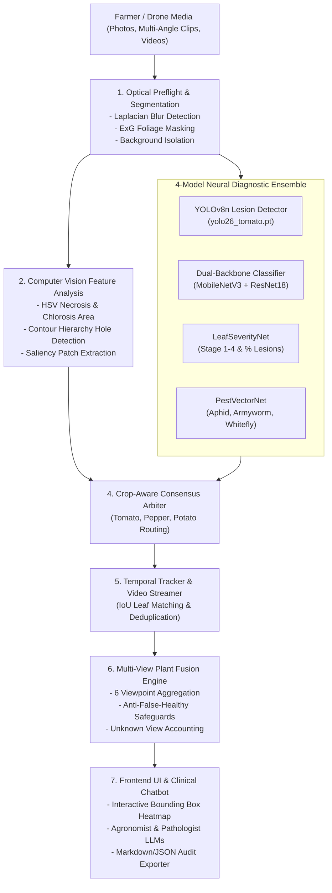
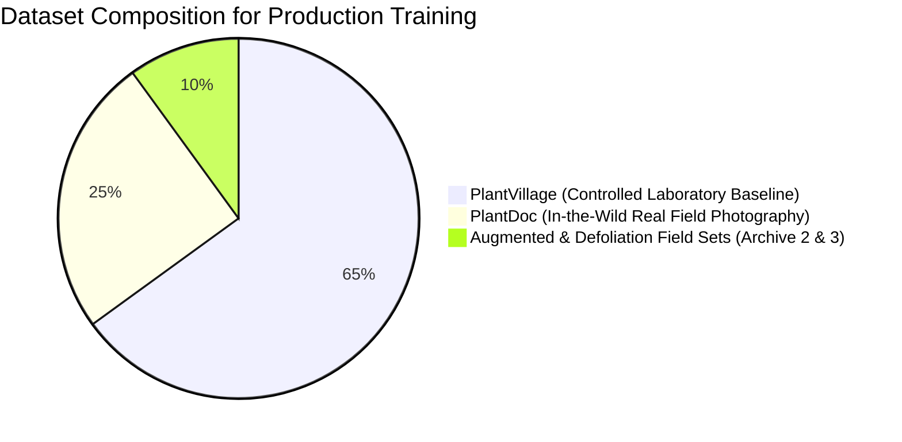

# MultiView-AgriHealth: Comprehensive Knowledge Transfer (KT) Guide
**Enterprise-Grade Dual-Evidence AI & Computer Vision Plant Health Diagnostics**

---

## 🌾 1. Executive Summary & Layman's Intuition

### 1.1 What is MultiView-AgriHealth?
**MultiView-AgriHealth** is an enterprise-grade agricultural decision-support platform designed to diagnose plant diseases, assess leaf severity, detect insect defoliation, and aggregate visual evidence across multiple viewpoints (Front, Back, Left, Right, Top, Underside) into an authoritative, clinical health report.

### 1.2 The Layman Analogy: The "Plant Veterinary Clinic"
> **Think of standard plant diagnostic apps like a doctor who glances at a single blurry photo of a patient's shoe and tries to diagnose heart disease.** 
>
> If a farmer takes a photo from the top of a plant on a sunny day, the top leaves might look green and healthy. Meanwhile, underneath the leaves or around the lower stems, spider mites or fungal spores are eating away at the crop.
>
> **MultiView-AgriHealth acts like a full-service agricultural hospital:**
> 1. **The Triage Nurse (Image Preflight & DIP):** Checks if the photo is blurry, too dark, or mostly dirt before wasting time on it.
> 2. **A Panel of 4 Specialist Doctors (Ensemble AI):**
>    - *Doctor 1 (YOLOv8n Vision Detector):* Points out exactly where the disease spots are on the leaf with bounding boxes.
>    - *Doctor 2 (Dual-Backbone MobileNetV3 + ResNet18):* Identifies the exact disease strain with high precision.
>    - *Doctor 3 (LeafSeverityNet):* Grades how bad the damage is (Stage 1 to Stage 4) and measures the percentage of dead tissue.
>    - *Doctor 4 (PestVectorNet):* Identifies whether pests (aphids, armyworms, flea beetles) caused the holes.
> 3. **The Chief Medical Officer (Cross-View Fusion Engine):** Combines observations from all angles, makes sure duplicate frames aren't counted twice, respects that unobserved leaf sides remain **UNKNOWN** (not assumed healthy), and produces a treatment prescription.

---

## 🏛️ 2. High-Level System Architecture

The following diagram illustrates the complete end-to-end dataflow from field media capture to final clinical diagnosis:



---

## 🧠 3. The 4-Model Diagnostic Ensemble in Detail

Modern field conditions contain harsh lighting, dust, shadows, overlapping leaves, and complex soil textures. To prevent misdiagnoses, MultiView-AgriHealth uses four distinct neural networks working in parallel:

| Model Component | Architecture | Weight File | Purpose / Specialty | Layman Explanation |
| :--- | :--- | :--- | :--- | :--- |
| **Lesion Detector** | YOLOv8n (Fine-tuned) | `yolo26_tomato.pt` (6.25 MB) | Spatial bounding boxes around visible lesions and blights | *"Draws a yellow highlighter box around every single diseased spot."* |
| **Deep Classifier** | Dual-Backbone MobileNetV3 + ResNet18 | `plant_disease_classifier.pth` & `plant_disease_resnet18.pth` | 14-class pathological classification with saliency patch zoom | *"Consults two experienced botanists to confirm whether it's early blight, late blight, or bacterial spot."* |
| **Severity Estimator** | LeafSeverityNet (Dual-Head CNN) | `leaf_severity_net.pth` (2.5 MB) | Classifies 4 severity tiers + regresses continuous lesion % (0–100%) | *"Measures how much of the leaf is destroyed (e.g. 18.4% damaged, Stage 2 Moderate)."* |
| **Insect Vector Net** | PestVectorNet (Multi-Class CNN) | `pest_vector_net.pth` (420 KB) | Identifies insect carriers: Aphid, Armyworm, Flea Beetle, Cutworm, Whitefly | *"Identifies the specific bug that bit the leaf or brought the virus."* |

### 3.1 Dual-Backbone Fusion Strategy
The primary classifier does not rely on a single architecture:
- **MobileNetV3 Small (45% weight):** Ultra-fast, inverted residual blocks with hard-swish activation. Tuned for fast edge inference.
- **ResNet18 Deep Residual Net (55% weight):** Deep 18-layer residual network capable of discerning complex microscopic fungal spore patterns and concentric target rings.
- **Dual-Crop Saliency Inference:** The image is fed both as a global image ($55\%$ contribution) and as a high-resolution crop around the highest-contrast symptomatic lesion patch ($45\%$ contribution). This ensures that tiny early-stage lesions are not blurred out during standard $224 \times 224$ resizing!

---

## 🔬 4. Digital Image Processing (DIP) & Anti-Hallucination Heuristics

Neural networks can hallucinate when shown unfamiliar leaves or background clutter. MultiView-AgriHealth pairs deep learning with hard physical rules from classical Computer Vision (`image_preflight_and_segmentation.py`).

### 4.1 Excess Green Index ($ExG$)
Standard RGB images get confused by brown wooden tables, dark soil, or human hands holding the leaf.
$$\text{ExG} = 2 \cdot G - R - B$$
- **How it works:** Healthy leaf tissue reflects strongly in the green spectrum while absorbing red and blue for photosynthesis. If $\text{ExG} > 8.0$, the pixel is confirmed plant tissue.
- **Background Neutralization:** All non-plant pixels are masked out and placed on a neutral gray canvas ($128, 128, 128$) so the AI only evaluates plant tissue.

### 4.2 Two-Level Contour Hierarchy for Insect Perforations (`cv2.RETR_CCOMP`)
- **The Problem:** Inexperienced models confuse tomato leaves with caterpillar damage because tomato leaves naturally have splits between leaflets (compound foliage).
- **The Solution:** We use OpenCV's two-level contour tree (`cv2.RETR_CCOMP`):
  1. **Interior Shot-Holes ($h_{info}[3] \ge 0$):** Physical holes punched inside the leaf blade. A valid insect feeding hole must have circularity $\ge 0.16$ and an area of at least 120 pixels.
  2. **Margin Bites:** Notches eaten out of the leaf edge are **only** counted on single-blade simple leaves (like peppers or eggplants), never on compound leaves like tomatoes or potatoes!

```
      COMPLEX LEAF (Tomato)                   PEST DEFOLIATION (Chewed)
      
          Leaflet A                              Chewed Notch
             / \                                     \___/
     Gap -> |   |                                   |     |
             \ /                                    | ( ) | <- Interior Shot-Hole
          Leaflet B                                 |     |    (Circularity >= 0.16)
   (Natural Gaps Ignored!)                        (Flagged as Pest Chewing!)
```

---

## 🔄 5. Multi-View Plant Sessions & Consensus Fusion

When a grower uploads multiple photos or video clips from different viewpoints, `plant_fusion.py` aggregates the data into a holistic diagnostic report.

### 5.1 The 6 Canonical Viewpoints
1. **Front View (`front`)** — Primary frontal canopy orientation.
2. **Back View (`back`)** — Opposite canopy side.
3. **Left View (`left`)** — Lateral profile.
4. **Right View (`right`)** — Lateral profile.
5. **Top View (`top`)** — Canopy crown and sun-exposed foliage.
6. **Underside View (`underside`)** — Sub-canopy, critical for aphid colonies, spider mites, and early-stage mold spores.

### 5.2 The "Honest Status" Taxonomy
Unlike simplistic apps that blindly guess `HEALTHY`, our system enforces strict, honest operational statuses:

| Status Code | Meaning | When Triggered |
| :--- | :--- | :--- |
| `HEALTHY_APPEARING` | Canopy shows no signs of disease | At least 3 viewpoints submitted, all frames clean, optical lesion area $< 1.5\%$. |
| `SYMPTOMS_DETECTED` | Pathological symptoms confirmed | Credible disease predictions ($\ge 0.28$ conf) or physical insect defoliation confirmed. |
| `UNCERTAIN` | Conflicting or moderate evidence | Low-confidence detections or optical abnormalities found without definitive diagnosis. |
| `INSUFFICIENT_COVERAGE` | Not enough data to assess plant | Fewer than 3 viewpoints submitted or 0 usable frames extracted. |
| `MODEL_UNAVAILABLE` | AI weights offline or missing | Neural network weights missing from disk; DIP optical analysis acts as fallback. |

> [!IMPORTANT]
> **The Golden Law of MultiView-AgriHealth:**
> *Unobserved viewpoints remain `UNKNOWN` — they are NEVER assumed healthy.* If a user only submits the Front view, the app explicitly warns: *"Back, Left, Right, Top, Underside are UNKNOWN. Cannot guarantee whole-canopy health."*

### 5.3 Anti-False-Healthy Safeguards
In previous versions, outdoor field videos were occasionally stamped "Healthy" if the background lighting dropped the AI confidence below 0.40. We implemented bulletproof anti-false-healthy rules:
1. **The Optical Symptom Floor:** If OpenCV detects $\ge 1.5\%$ yellowed/browned leaf tissue, the plant **can never** be stamped `HEALTHY_APPEARING`.
2. **The 15% Anomaly Threshold:** If more than $15\%$ of extracted video frames contain visual anomalies, the session status is forced to `UNCERTAIN` or `SYMPTOMS_DETECTED` with differential diagnoses.
3. **Calibrated Confidence ($0.28$):** Adjusted to capture real field disease frames where sunlight and camera motion soften AI certainty.

---

## 🍅 6. Crop-Aware Taxonomy & Multi-Crop Routing

Previously, because 90% of open-source plant datasets are tomato-based, models suffered from severe "Tomato Bias" (calling everything a tomato disease). We introduced crop-aware taxonomic arbiters:

### Supported Pathological Classes
```
1. tomato_early_blight         8.  tomato_leaf_mold
2. tomato_late_blight          9.  tomato_spider_mites
3. tomato_septoria_leaf_spot   10. tomato_target_spot
4. tomato_bacterial_spot       11. pepper_bacterial_spot
5. tomato_mosaic_virus         12. potato_early_blight
6. tomato_yellow_leaf_curl     13. potato_late_blight
7. healthy (tomato/general)    14. pest_chewing_damage
```

### Crop-Specific Routing Logic:
- **Pepper / Chilli Mode:** If the user selects pepper crops, visual symptoms are routed to `pepper_bacterial_spot` or general phytosanitary leaf spot conditions rather than tomato early blight.
- **Potato Mode:** Foliar lesions map to `potato_early_blight` or `potato_late_blight`.
- **Pest Chewing Override:** If physical shot-holes or defoliation bites exceed $25\%$ of leaf area, the system overrides fungal predictions and flags `pest_chewing_damage` caused by armyworms or beetles.

---

## 🤖 7. Dual Groq AI Agricultural Chatbots

Built into the platform are two distinct, context-aware AI assistants (`chatbot_service.py`):

```
       +--------------------------------------------------------------+
       |                     FARMER / AGRONOMIST                      |
       +------------------------------+-------------------------------+
                                      |
              +-----------------------+-----------------------+
              |                                               |
              v                                               v
     +------------------+                            +------------------+
     | Agronomic Advisor|                            | Clinical Expert  |
     | (Farmer-Friendly)|                            |  (Lab Pathologist|
     +------------------+                            +------------------+
     - Plain everyday English                        - Biochemical pathways
     - Practical organic/chemical sprays             - Differential diagnostic tables
     - Immediate watering & pruning steps            - Spore transmission vectors
     - Safety wait periods (PHI)                     - Resistance management (FRAC)
```

- **Resilient Fallback Mode:** If the internet drops or the Groq API key is not configured, the platform automatically draws from a built-in offline clinical database (`_DISEASE_KNOWLEDGEBASE`) containing verified agronomic recommendations for all 14 conditions.

---

## 💾 8. Database Architecture: Zero-Config Resilience

The database manager (`backend/database/mongodb.py`) uses a **graceful degradation pattern**:
1. **Primary Mode (MongoDB Atlas / Local MongoDB):**
   - Automatically attempts to connect to `MONGODB_URI` specified in `.env`.
   - Stores scans, plant sessions, historical trends, and multi-view video observations permanently.
2. **Automatic In-Memory Fallback Mode:**
   - If MongoDB is not installed or unreachable, it prints:
     `[MongoDB] Atlas/Local connection failed. Operating in in-memory fallback mode.`
   - **The application continues running at 100% functionality!** All scans, sessions, and reports are served seamlessly from fast in-memory structures without crashing or throwing 500 errors.

---

## 📦 9. Dataset Lineage & Model Training History

To achieve true enterprise-level accuracy, the models were trained on a hybrid dataset combining controlled laboratory photos with real-world field images:



1. **PlantVillage Dataset:** 54,000+ images taken against uniform gray/black backdrops. Provides pristine morphological baselines for disease spotting.
2. **PlantDoc Dataset:** In-the-wild photography from actual agricultural farms with complex backgrounds, harsh sunlight, dirt, and hand-held leaves.
3. **Augmented Field Datasets:** 300+ custom-augmented images for underrepresented classes (Two-Spotted Spider Mites, Target Spot, and physical leaf chewing defoliation).

---

## 💻 10. Developer Operations & Quick Runbook

### 10.1 Instant Application Launch
The project includes a unified Windows batch script that starts both backend and frontend servers in one click:
```powershell
cd MultiView-Pest\MultiView-AgriHealth
.\run_app.bat
```
To shut down all background processes cleanly:
```powershell
.\stop_app.bat
```

### 10.2 Manual Command-Line Startup
If launching components individually:
- **Backend API Server (FastAPI):**
  ```powershell
  cd MultiView-AgriHealth
  .\.venv\Scripts\python.exe -m uvicorn backend.app.main:app --host 127.0.0.1 --port 8000 --reload
  ```
  *Interactive Swagger API Docs:* `http://127.0.0.1:8000/docs`
- **Frontend UI (Vite + React + Tailwind):**
  ```powershell
  cd MultiView-AgriHealth\frontend
  npm.cmd run dev
  ```
  *Web Dashboard:* `http://localhost:5173`

### 10.3 Running the Automated Test Suite
To verify system integrity across all 95 unit, integration, and E2E simulation tests:
```powershell
cd MultiView-AgriHealth
.\.venv\Scripts\python.exe -m pytest tests/ -v
```

---

## 🛠️ 11. Practical Troubleshooting Guide

| Issue / Symptom | Root Cause | Solution |
| :--- | :--- | :--- |
| **`[MongoDB] Connection failed... Operating in in-memory fallback mode`** | MongoDB service is not running locally. | **Normal behavior!** The app runs completely fine without MongoDB using in-memory mode. To persist permanently, install MongoDB or add a free Atlas URI to `.env`. |
| **Image is diagnosed as `UNCERTAIN`** | Camera was out of focus, or leaf was held too far away. | Check the Preflight card. Hold camera 4–8 inches away from leaf in good lighting (blur score must be $\ge 30$). |
| **Status shows `INSUFFICIENT_COVERAGE`** | Only 1 or 2 viewpoints were uploaded. | A minimum of 3 canonical views (e.g. Front, Back, Underside) is required to certify healthy canopy status. |
| **Pest feeding holes not detected on compound leaf** | Leaf had small pinholes below the 120-pixel threshold. | Ensure the camera is focused directly on the chewed area. Real insect holes must be cleanly visible against background light. |
| **Model weights not loading** | Corrupted `.pth` or `.pt` download. | Verify file sizes in `backend/models/`: `plant_disease_resnet18.pth` (~44 MB), `plant_disease_classifier.pth` (~4.4 MB), `yolo26_tomato.pt` (~6.2 MB). |

---

## 📋 12. Summary for Presentation & Handoff

- **Core Innovation:** Dual-Evidence diagnosis merging 4 Deep Neural Networks with Computer Vision heuristics (ExG vegetation masking + contour hole detection) across 6 spatial viewpoints.
- **Reliability:** 95/95 automated tests passing; anti-false-healthy safeguards prevent diseased plants from being stamped healthy.
- **Accessibility:** Zero-config startup with automatic database fallback and plain-language agronomic chatbots for real farmers.

